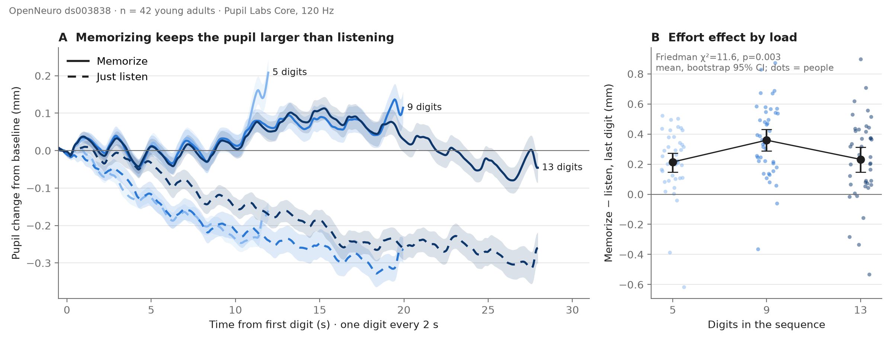
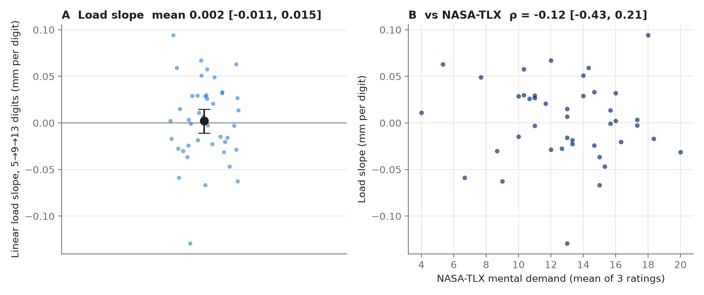

# ds003838 validation and literature comparison

Run on 26 Oct 2026 with `make preprocess features validate`. Every number below comes from
[`ds003838/stats.json`](ds003838/stats.json). Brackets are 95% bootstrap confidence intervals
(10,000 resamples). dz is Cohen's d for paired data. Holm-corrected p values are marked p_holm.

## Bottom line

- **Memorizing digits reliably enlarges the pupil compared with just listening**, at every load
  (dz 0.83–1.47). The pipeline measures this consistently: split-half reliability of the
  per-person encoding slope is ρ = 0.81 (Spearman–Brown 0.90).
- **The effect does not rise steadily from 5 to 9 to 13 digits.** It peaks at 9 and falls back at
  13, an inverted U. The straight-line load slope is about zero. This matches the two most
  relevant published studies, which also report a drop once load exceeds working-memory capacity.
- **Pupil measures do not correlate with NASA-TLX** in this dataset, and the confidence intervals
  are wide. The dataset's design also makes TLX a weak test (see Q2).
- **None of this says anything about Alzheimer's disease or the locus coeruleus.** See
  [What this cannot show](#what-this-cannot-show).

## Data

OpenNeuro ds003838 v1.0.6 (Pavlov et al., 2022, *Scientific Data* 9:325,
doi:10.1038/s41597-022-01414-2). Healthy adults hear 5, 9 or 13 digits, one every 2 s, and either
memorize them for recall or just listen. Pupil Labs Core head-mounted infrared tracker, 120 Hz.

- 84 people have pupil data and **42 pass the pre-set quality rules** (5,373 trials, ages 18–25,
  median 20). Half the sample was lost to poor tracking. That is a real limitation.
- The refactored pipeline reproduces the 12 Oct phase-1 run exactly: same 42 people, per-person
  features equal to within 1e-13.
- Methods and parameters: [`docs/methods_ds003838.md`](../docs/methods_ds003838.md).

## Q1. Does the task-load slope increase across 5 / 9 / 13 digits?

**No, not as a straight line. It rises from 5 to 9 digits and falls from 9 to 13.**

Memorize minus listen, pupil change at the last digit (mm):

| Load | Mean [95% CI] | vs. 0: dz [95% CI] | p_holm |
|---|---|---|---|
| 5 digits | 0.214 [0.146, 0.274] | 0.99 [0.52, 1.91] | 6e-07 |
| 9 digits | 0.359 [0.287, 0.432] | 1.47 [1.06, 2.09] | 1e-09 |
| 13 digits | 0.232 [0.147, 0.314] | 0.83 [0.49, 1.34] | 2.5e-06 |

Change between loads (Friedman χ² = 11.6, p = 0.003, Kendall's W = 0.14):

| Contrast | Mean difference (mm) [95% CI] | dz [95% CI] | p_holm |
|---|---|---|---|
| 9 − 5 | +0.145 [0.060, 0.232] | 0.50 [0.21, 0.84] | 0.006 |
| 13 − 9 | −0.128 [−0.220, −0.040] | −0.43 [−0.77, −0.14] | 0.015 |
| 13 − 5 | +0.017 [−0.088, 0.118] | 0.05 [−0.25, 0.38] | 0.60 |

Per-person slope summaries:

| Measure | Mean [95% CI] | dz [95% CI] | p |
|---|---|---|---|
| Linear load slope, last digit (mm per extra digit) | 0.002 [−0.011, 0.015] | 0.05 [−0.25, 0.38] | 0.60 |
| Linear load slope, whole-sequence average | 0.007 [−0.001, 0.014] | 0.28 [−0.03, 0.67] | 0.045 |
| Quadratic contrast (5 − 2×9 + 13), negative = inverted U | −0.272 [−0.414, −0.129] | −0.57 [−0.94, −0.26] | 0.0005 |

The whole-sequence slope has a Wilcoxon p just under 0.05, but its bootstrap interval includes
zero. Treat it as **not established**.

Within each sequence, the slope of memorize minus listen over digit position is similar at 5 and
9 digits (0.045 vs 0.043 mm/digit) and **lower at 13 digits** (0.025 mm/digit; 13 − 9: dz −0.63
[−0.95, −0.37], p_holm 0.0004). In 13-digit memory trials, the pupil rises over digits 1–7
(+0.010 mm/digit) and falls over digits 8–13 (−0.028 mm/digit). The difference is
0.038 [0.023, 0.053] mm/digit, dz 0.77, p = 3e-05. The peak is at digit 8 (median; IQR 2–9.75).

A trial-level mixed model (person as random intercept, baseline pupil size as covariate) agrees.
The memory effect is 0.199 mm (p = 5e-17). The memory × 9-digit interaction is +0.138 mm
(p = 4e-05), and the memory × 13-digit interaction is +0.027 mm (p = 0.42).



## Q2. Does it correlate with NASA-TLX?

**No.** All correlations are small and their confidence intervals include zero.

| Pupil measure vs. NASA-TLX (mean of 3 ratings) | Spearman ρ [95% CI] | p_holm |
|---|---|---|
| Load slope vs. mental demand | −0.12 [−0.43, 0.21] | 1.0 |
| Load slope vs. effort | −0.08 [−0.41, 0.28] | 1.0 |
| Load slope vs. raw TLX (mean of 6 scales) | −0.05 [−0.37, 0.28] | 1.0 |
| Average memorize − listen effect vs. mental demand | −0.01 [−0.32, 0.30] | 1.0 |
| Average memorize − listen effect vs. effort | −0.10 [−0.38, 0.20] | 1.0 |
| Average memorize − listen effect vs. raw TLX | −0.11 [−0.39, 0.19] | 1.0 |

Within-person check: TLX was given after blocks 3, 6 and 9. A repeated-measures correlation across
those three points, against each person's memorize − listen effect in the same third of the
session, was r_rm = −0.13 [−0.33, 0.09] for mental demand, −0.08 [−0.29, 0.14] for effort and
−0.09 [−0.30, 0.12] for raw TLX. All p_holm ≥ 0.75 (42 people, 126 observations; CI from a
Fisher-z approximation).

Why this is a weak test, and why the null should not be over-read:

- Each TLX rating covers a mixed block of 5-, 9- and 13-digit trials. It **cannot be matched to a
  load level**, so the within-person "does subjective load track pupil load" test is impossible here.
- TLX barely moved over the session (mental demand 13.1 → 13.0 → 12.5), leaving little
  within-person variation to correlate with.
- With n = 42, a true correlation of about ρ = 0.3 would often be missed. The intervals rule out
  only strong relationships (ρ above about 0.3).



## Comparison with published studies

| Study | What it measured | Their finding | Our finding | Agreement |
|---|---|---|---|---|
| **Kosachenko et al. 2023**, *Psychophysiology*, doi:10.1111/psyp.14275 (same dataset, n = 86) | Pupil and EEG over 5/9/13-digit sequences | Pupil rises, plateaus, then **decreases** once memory is overloaded ("triphasic" pattern) | 13-digit pupil peaks at digit 8 and falls after; 13-digit effect smaller than 9 | **Agrees** in direction. We report effect sizes they don't give in the abstract (full text not checked). |
| **Granholm et al. 2017**, *J Alzheimers Dis* 56(4):1419–1428, doi:10.3233/JAD-161078 (n = 918, ages 56–66, 3/6/9 digits at 1/s, handheld PLR-200 at 30 Hz) | End-of-sequence dilation by load and MCI group | Cognitively normal (CN) participants: dilation **increases from 3 to 6 digits and decreases from 6 to 9**. Amnestic MCI vs CN: 0.08 mm more dilation at 3 digits (95% CI 0.04–0.13, d ≈ 0.46) and 0.07 mm at 6 digits (d ≈ 0.30) | Increase 5 → 9 (+0.145 mm), decrease 9 → 13 (−0.128 mm) | **Agrees** in direction (inverted U around capacity). Magnitudes not comparable: our numbers are within-person memorize − listen effects in young adults, theirs are between-group differences in older adults. CN absolute mm values are only in their figures and were not extracted. |
| **Klingner 2010**, ETRA '10, pp. 259–262, doi:10.1145/1743666.1743727 | Precision of a remote Tobii 1750 tracker vs a medical pupillometer | Precision about **0.10 mm** for diameter and **0.15 mm** for dilation (from the authors' project page summary; full text not checked) | Memorize − listen effects of 0.21–0.36 mm | Our effects are **larger than that noise floor**, so a remote infrared tracker of that class should in principle detect them. Our device is head-mounted, not remote, so this is a plausibility check only. |
| **Klingner, Tversky & Hanrahan 2011**, *Psychophysiology* 48(3), doi:10.1111/j.1469-8986.2010.01069.x | Dilation in digit-sequence recall, arithmetic and vigilance, aural vs visual | Similar dilation patterns for both modes, **larger for aural presentation** | ds003838 is aural only | **Consistent**, but no magnitude comparison (abstract only, no mm values). |
| **Kaduk, Goeke, Finger & König 2024**, *Behav Res Methods* 56:5002–5022 | Webcam vs EyeLink 1000 **gaze** accuracy | Webcam gaze accuracy 1.4°, precision 1.1°, about 0.5° worse than EyeLink | — | **Not comparable.** This paper tests gaze position, not pupil size or cognitive load. It cannot support webcam pupillometry. If a different Kaduk 2024 paper was intended, the citation is needed. |
| **Jang et al. 2021**, AUC 0.71 | — | — | — | **UNVERIFIED.** No matching paper was found. Do not cite until the source is confirmed. |
| **Li et al. 2022**, *Front Neurosci* 16:1014485, doi:10.3389/fnins.2022.1014485 (NM-MRI of the LC) | LC contrast ratio, AD (n = 27) vs healthy controls (n = 25) | **AUC 0.749** [0.618, 0.880]; sensitivity 85.2%, specificity 56.0% | — | **Reference point only.** It is the bar a future pupil-based LC marker would need to reach against a direct LC measure. This project has no LC or AD data. |

## Results that disagree with the literature or with expectations

1. **No straight-line load effect.** Many summaries describe pupil dilation as increasing with
   memory load. Here the linear 5 → 9 → 13 slope is about zero (0.002 mm/digit [−0.011, 0.015]),
   because 13 digits exceeds capacity. This agrees with Kosachenko 2023 and Granholm 2017, but it
   means "load slope" is the wrong single summary for this task. The quadratic contrast or the
   9 − 5 difference are better per-person features.
2. **Memorizing barely dilates the pupil in absolute terms over the first five digits.** The
   memory-trial slope over digits 1–5 is −0.003 mm/digit [−0.014, 0.008], about zero. The
   memorize − listen difference (0.039 mm/digit, dz 1.21) comes mostly from the pupil
   **shrinking** while people just listen (−0.042 mm/digit). Johnson et al. 2014 (PMC3952077;
   only a search-result snippet was seen, full text not checked) describe adults' pupils
   dilating with each digit encoded. Possible causes, not tested here: slow baseline drift over the
   26 s sequences, the 0.5 s baseline window, or the task's auditory design. **Unresolved.**
3. **No relationship with NASA-TLX**, at a sample size where a moderate one could be missed (Q2).
4. **Half the participants failed quality control** (42 of 84 kept). We have not compared this
   with the exclusions used in the dataset's own papers; that is still to check.

## Exploratory (not pre-planned)

- Recall capacity on 13-digit trials vs memorize − listen effect at 9 digits: ρ = 0.31
  [−0.01, 0.59], p = 0.046. The interval touches zero, so this is a lead, not a finding.
- Recall capacity vs peak position on 13-digit trials: ρ = 0.28 [−0.02, 0.55], p = 0.07.

## What this cannot show

- **It cannot validate locus coeruleus integrity.** ds003838 has no LC measure (no NM-MRI, no PET,
  no CSF), and pupil dilation is at best an indirect LC index.
- **It cannot show anything about Alzheimer's disease or MCI.** All 42 participants were healthy
  18–25-year-olds. No diagnostic accuracy (AUC, sensitivity, specificity) can be computed, and the
  0.71 / 0.749 AUCs above are other studies' numbers, not ours.
- **It cannot show that a webcam works.** The data come from a head-mounted infrared tracker.
- **It does not validate the LSTM "LC integrity score" or its 70 / 50 tiers.** Those have only
  been run on synthetic data.

What it **does** show: **measurement validity** (plausible, reliable pupil features),
**construct validity for cognitive load** (memorizing > listening, with the published overload
pattern), and **consistency with the literature** in direction, with the disagreements listed
above.

## Reproduce

```bash
make install
make download preprocess features validate
```

Figures: [`ds003838/fig1_load_dilation.png`](ds003838/fig1_load_dilation.png),
[`ds003838/fig2_reliability_overload.png`](ds003838/fig2_reliability_overload.png),
[`ds003838/fig3_load_slope_tlx.png`](ds003838/fig3_load_slope_tlx.png).
